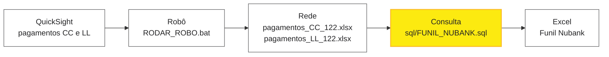

<div align="center">

# 🟡 Funil Nubank · Robô QuickSight

**Do QuickSight ao funil em uma rotina: o robô baixa, a consulta monta, o Excel mostra.**


Planejamento · Personal — *Excelência em relacionamentos.*

[Rotina diária](#-rotina-diária) · [Backup](#-backup-da-produção) · [Testes](#-testar-sem-risco) · [Ajustes](#-onde-ajustar) · [Erros](#-deu-erro) · [Documentação](#-documentação) · [Máquina nova](#-máquina-nova)

</div>

---

## Em 30 segundos



O robô entra no QuickSight com a sua sessão do Okta, exporta os pagamentos de CC e LL, confere o arquivo e grava na pasta oficial da rede. A consulta SQL junta esses pagamentos com a base, os acordos e as discagens, e devolve o funil de CC e LL, mês atual contra mês anterior, com o mesmo número de dias úteis.

---

## 🚀 Rotina diária

> **Tempo total:** cerca de 1h30, quase tudo esperando a consulta.

**1 · Robô** · *alguns minutos*

1. Dê dois cliques em `BACKUP_PRODUCAO.bat` para guardar uma cópia dos arquivos oficiais de hoje.
2. Dê dois cliques em `RODAR_ROBO.bat`.
3. Se o Chrome abrir pedindo login, entre no Okta, volte à janela preta e aperte **Enter**.
4. Espere `RESULTADO: OK`.

**2 · Consulta** · *cerca de 1h*

1. No SSMS, selecione o banco **`planejamento`** e abra `sql/FUNIL_NUBANK.sql`.
2. Rode com `@APENAS_MOSTRAR_PERIODOS = 1` e confira as datas na aba Mensagens.
3. Troque para `0` e execute. Não feche a janela até copiar o resultado.

**3 · Entrega**

1. Cole o resultado na aba **Dados** do Excel Funil Nubank.
2. Atualize a Tabela Dinâmica.

Os buckets "(vazio)" e "00" já saem retirados pela consulta.

> [!IMPORTANT]
> Não rode o robô enquanto a consulta estiver executando. Ele troca o Excel de pagamentos que a consulta está lendo.

---

## 🛟 Backup da produção

O `BACKUP_PRODUCAO.bat` copia os dois arquivos oficiais da rede para `backup_producao\AAAAMMDD_HHMMSS\` nesta pasta.

**Quando rodar:**
- todo dia, antes do robô (passo 1 da rotina);
- antes de mudar o `qs_download.py` ou o `config_producao.yaml`;
- antes de usar `--baixar-tudo`, que substitui o arquivo inteiro.

**Para voltar ao backup:** copie os dois arquivos da pasta do backup de volta para a pasta oficial, por cima dos atuais.

**Para não acumular:** apague os backups antigos uma vez por mês.

> [!WARNING]
> O caminho da pasta oficial está escrito dentro do `.bat` (linha `set "PASTA=..."`). Se o destino mudar no `config_producao.yaml`, mude também aqui.

O robô ainda guarda sozinho uma cópia datada de cada arquivo publicado na pasta **HISTORICO** da rede, por 60 dias.

---

## 🧪 Testar sem risco

| Comando | O que faz | Esperado |
| --- | --- | --- |
| `python qs_download.py --debug --check` | Navega e testa os cliques, sem baixar | `CHECK_OK` |
| `python qs_download.py` | Download real, gravado só em `teste_saida\` | `Fim da execução: tudo OK` |

Rode com o ambiente ativo: `.venv\Scripts\Activate.ps1`.

> [!TIP]
> Só o `RODAR_ROBO.bat` grava na rede, porque só ele usa o `config_producao.yaml`. O `config.yaml` de teste tem três travas: destino alternativo, `publicar_na_rede: false` e bloqueio se o destino de teste for igual ao de produção.

---

## 📁 O que tem nesta pasta

```text
RoboQuickSight/
├── qs_download.py          o robô
├── config_producao.yaml    produção: grava nos arquivos oficiais
├── config.yaml             teste: grava só em teste_saida\
├── RODAR_ROBO.bat          rodada diária (duplo clique)
├── BACKUP_PRODUCAO.bat     backup dos arquivos oficiais
├── requirements.txt        bibliotecas Python
├── sql/
│   └── FUNIL_NUBANK.sql    consulta do funil (CC + LL)
└── docs/
    └── documentacao_funil.pdf
```

<details>
<summary><b>Pastas criadas pelo robô</b> (ficam fora do GitHub)</summary>

| Pasta | Para quê | Pode limpar? |
| --- | --- | --- |
| `.venv` | Bibliotecas Python | Não. Recrie com `pip install -r requirements.txt` |
| `sessao` | Login do Okta salvo | Não. Sem ela, o robô pede login de novo |
| `logs` | Log de cada rodada e prints de erro (`evidencias`) | Sim |
| `staging` | Download temporário antes da conversão | Sim |
| `teste_saida` | Saída dos testes | Sim, o conteúdo |
| `backup_producao` | Backups do `BACKUP_PRODUCAO.bat` | Sim, os antigos |

</details>

---

## 🧠 Como o robô decide o que baixar

O arquivo de pagamentos sempre traz **3 meses**: retrasado, anterior e atual.

- **Mês fechado**, já completo no arquivo anterior: é reaproveitado, sem download. Aparece como `PULADO` no log.
- **Mês aberto** ou defasado: é baixado de novo.
- **Início do mês**, quando o QuickSight ainda não tem o mês atual: o robô reaproveita o arquivo anterior e termina com `OK_CACHE_FALLBACK`.

**Antes de publicar, o robô confere:**
- se as colunas obrigatórias estão no arquivo;
- se há pelo menos 2 tipos de pagamento;
- se a data mais recente tem menos de 4 dias (acima disso, só avisa).

No LL, as linhas `deal_type = not-commissioned` são excluídas. A linha `DATA DE CORTE` do log mostra o último pagamento disponível no QuickSight.

---

## 🔧 Onde ajustar

| Quero... | Mexa em |
| --- | --- |
| Corrigir cliques depois de mudança no QuickSight | `steps` nos **dois** `.yaml`, depois teste com `--debug --check` |
| Mudar a pasta oficial | `destination` no `config_producao.yaml` **e** `PASTA` no `BACKUP_PRODUCAO.bat` |
| Atualizar feriados | `periodo.feriados` nos **dois** `.yaml` **e** no BLOCO 0 do SQL |
| Mudar a tolerância de defasagem | `freshness_max_age_days` nos `.yaml` |
| Mudar período, corte ou dias úteis do funil | BLOCO 0 do `FUNIL_NUBANK.sql` |

---

## 🩺 Deu erro?

| Sintoma | O que fazer |
| --- | --- |
| Chrome abre pedindo login | Sessão expirada: entre no Okta e aperte Enter na janela preta |
| Robô não encontra um botão | O QuickSight mudou: rode `--debug --check` e ajuste o `steps` |
| `Destino bloqueado` | Alguém está com o Excel de pagamentos aberto: feche e rode de novo |
| `Dados possivelmente desatualizados` | O QuickSight está atrasado; não é falha do robô |
| SQL diz "tabela não existe" | Selecione o banco `planejamento` no SSMS |

O log completo fica em `logs\qs_robo.log`, e os prints dos erros em `logs\evidencias\`.

<details>
<summary><b>Códigos de saída do robô</b></summary>

| Código | Significado |
| --- | --- |
| `0` | Tudo OK |
| `1` | Algum export falhou |
| `2` | Erro de configuração (`.yaml`) |
| `3` | Erro inesperado |
| `4` | Sessão expirada em modo `--nao-interativo` |

</details>

<details>
<summary><b>Todos os comandos</b></summary>

| Comando | Uso |
| --- | --- |
| `--config config_producao.yaml` | Usa a configuração de produção (é o que o `.bat` faz) |
| `--only pagamentos_CC` | Roda só um export |
| `--check` | Testa a navegação sem baixar |
| `--debug` | Navegador visível e log detalhado |
| `--baixar-tudo` | Ignora os meses fechados e baixa tudo de novo |
| `--login-manual` | Abre o navegador para login e salva a sessão |
| `--nao-interativo` | Nunca espera Enter (para o Agendador de Tarefas) |
| `--sim-date 2026-09-01` | Simula outra data |

</details>

---

## 📄 Documentação

| Arquivo | Onde |
| --- | --- |
| PDF (leitura) | [`docs/documentacao_funil.pdf`](docs/documentacao_funil.pdf) |
| Word (editável) | `\\10.10.2.55\planejamento\0. Time Plan - Mis (Lucas,Mikas,Pam e Italo)\12 - Guilherme` |

Ao mudar a documentação, edite o Word na rede, salve como PDF e substitua o arquivo em `docs/`.

---

## 💻 Máquina nova

Pré-requisitos: Python 3.13, Google Chrome, Git e acesso ao QuickSight, ao banco `planejamento` e às pastas da rede.

```powershell
git clone ENDERECO_DO_REPOSITORIO RoboQuickSight
cd RoboQuickSight
python -m venv .venv
.venv\Scripts\Activate.ps1
pip install -r requirements.txt
python qs_download.py --login-manual
```

Depois, troque o usuário no caminho do `destino_alternativo` do `config.yaml` e faça os dois testes.

---

## 🤝 Combinados

- **Teste antes de subir** qualquer mudança no robô, e faça o backup antes da primeira rodada de produção de uma versão nova.
- **Nunca suba** sessão, `.env`, logs ou planilhas. Confira o `git status` antes de cada commit.
- **Commits em português**, com prefixo: `feat:` (novidade), `fix:` (correção), `config:` (ajuste de `.yaml`), `docs:` (documentação).

<div align="center">

---

**Personal** · *Excelência em relacionamentos.*

</div>